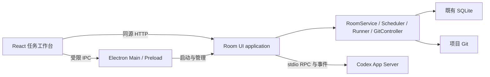

# ADR-0007：独立 Electron 与任务工作台

| 属性 | 内容 |
|---|---|
| 状态 | 产品方向已确认；技术细化 Proposed |
| 日期 | 2026-10-11 |
| Owner | Codex |
| 决策者 | 用户 |
| Reader | 用户、实施 Worker、Reviewer |
| 范围 | Room 桌面产品、SDD、任务驱动、测试驱动与旧入口清理 |
| 首个实施契约 | [DESKTOP-01](../../work/wf-electron-task-workbench/TASK_CONTRACT.md)（Accepted） |
| 产品交互细化 | [完整产品与 UI 方案](../ROOM_WORKBENCH_PRODUCT.md)（Draft） |

本文使用 MUST 表示必须满足的目标行为，SHOULD 表示默认建议，MAY 表示可选能力。下述目标不代表当前软件已实现。

## 1. 已确认方向与现状

用户于 2026-10-11 明确确认：“独立 Electron＋以任务为中心。要任务驱动，也要测试驱动”。原始目标同时要求 SDD、参考成熟 GitHub 仓库/开发文档/模块代码、审阅并清理无用文件，以及严格遵循 Stop That Shit。同日进一步明确来源分类，并要求完整按钮级产品/UI 方案与 TDD 操作讲解；这不表示已确认首个实施契约。

当前 React 页面按 Plan、Run、Question、Review、GitAction 划分，并要求输入实体 ID 和 JSON。当前 Tauri launcher 启动 Codex Desktop，通过 CDP 注入 iframe；因此独立 Electron 需要替换启动与交互路径。既有 RoomService、SQLite、GitController 和 Claude Runner 仍有实际消费者，保留其可用能力。

仓库开发用的 `tools/codex-github-bridge/codex-app-server.mjs` 是一次性 ephemeral Worker transport，不是产品内持续对话客户端；不能把它原样接入后宣称原生 Plan、用户提问与恢复已完成。

## 2. 使用者操作模型

用户操作的对象是一项需求；内部 Plan、Task、Run、Attempt 等引用由应用建立，技术详情按需展开。

主界面采用项目与任务列表、任务内容区、可收起详情区。任务内容区包含对话、方案、变更、测试；统一“待我处理”入口定位问题、审批和验收。设置只包含项目、Agent、主题及实际支持的执行配置。

完整主路径：

1. 打开项目文件夹，识别 Git、已有 Room 和 Agent 可用情况。已有数据继续使用；没有 Room 时明确创建。
2. 新建任务，输入目标，选择“SDD”或“任务模式”，附加需要阅读的来源。
3. Agent 读取来源、提出必要问题，输出可编辑的范围、方案、步骤与验收条件。
4. 用户确认当前方案后执行；用户不手填内部 ID、节点 JSON 或 worktree 映射。
5. 同一任务显示进度、变更、测试及问题。回答改变范围时修订方案，不静默扩大执行范围。
6. 验收页显示实际 Diff、测试与 Review。用户接受或提出修改；Git 操作显示实际文件范围并遵循既有确认边界。

待办 MUST 可直接处理；操作失败保留输入和已有变更；切换项目 MUST 同时切换任务、会话与操作目标。任务列表不使用虚构统计。重新打开应用恢复持久化任务，进程已消失的执行不得仍显示为正在运行。

## 3. SDD、任务驱动与测试驱动

开发入口与验证方式是两个维度，避免把两个不同含义都缩写为 TDD。

| 维度 | 界面名称 | 行为 |
|---|---|---|
| 开发入口 | SDD | 来源阅读 → 规格与场景 → 技术方案与模块边界 → 任务拆分 → 实现、验证、文档更新 |
| 开发入口 | 任务模式 | 原生 Codex Plan → 精简任务计划与验收 → 确认执行 → 验证与交付 |
| 执行方法 | 测试驱动（TDD） | 在任一入口下按 Red → Green → Refactor 实施适用的行为变更 |

测试驱动 SHOULD 默认用于可自动验证的代码行为变更。用户可以对纯文案、文档或无可行自动化入口的任务选择普通验证；应用不得把没有运行测试的任务显示为 TDD 通过。

### 3.1 SDD 来源与 SOP

- 成熟 GitHub 仓库、模块代码文件、非本项目开发文档均用于参考实现与模块组织。
- 本项目开发文档用于确定需求、接口与约束；用户当前明确要求优先于旧文档。
- 当前项目代码和测试同时提供既有实现事实；与文档冲突时明确指出，不静默改写需求。详细来源分类及界面行为以[产品方案](../ROOM_WORKBENCH_PRODUCT.md#2-来源规则)为准。
- 来源冲突应写入方案供用户决定，外部仓库不能自动覆盖本项目要求。
- 参考 GitHub Spec Kit 的规格/计划/任务链路和 OpenSpec 的已有项目变更与归档方法；只采用需要的步骤，不同时安装两套规范系统。
- 规格、方案和任务保持一份权威内容，界面显示该内容；小任务可以在同一文档分节，不强制生成大量空文件。

### 3.2 原生 Plan 与 TDD 证据

独立客户端通过 Codex App Server 接入原生 Plan。使用安装版本实际提供的 `collaborationMode`，保留模式内置指令；实现时核对该版本的协议。模式不可用时显示原因，不把普通提示词模式标为“原生 Plan”。

计划阶段以只读权限进行代码调研；用户确认后进入执行。计划模式本身不等于测试驱动，也不代替 Room 对执行与 Git 的授权。

TDD 的必要证据：

1. Red：记录实际测试命令、目标用例和因预期行为缺失而失败的结果；环境错误不算 Red。
2. Green：针对同一行为进行最小实现，以实际测试结果证明通过。
3. Refactor：确有整理需要时进行等价重构，重跑受影响测试；无需重构时可以结束。

应用 MUST 从命令执行事实显示阶段和结果，不能只显示 Agent 自述。修复用例应覆盖原始症状，不能改弱断言来制造 Green；中断时保留失败用例和工作区以便继续。

## 4. 技术方向与数据所有权（Proposed）

- Electron 负责窗口、项目目录选择、通知、后台进程及安装更新生命周期；Renderer 不直接执行 Shell 或打开 SQLite。
- 继续使用现有 HTTP application 边界，供工作台和 taskctl 使用。MCP 保留实际执行器所需能力。
- Codex App Server 提供规划对话、提问与审批事件；由产品服务管理 thread/turn 关联。现有 Claude 执行路径继续可用；把 Codex 产品执行纳入 Room 时必须使用实际 Run/Attempt 语义，不能直接用仓库开发 Bridge 冒充产品 Runner。
- SQLite 继续拥有 Room 执行、审批和结果；Git 拥有代码事实。聊天记录由 App Server 拥有，Room 只保存恢复所需的关联，不复制成第二套会话权威。
- 当前 Plan schema 没有任务标题、开发入口、草稿或 thread 关联。新任务持久化必须在第二阶段契约中明确最小字段和所有者，再实现；不能把这些事实只放在 localStorage 或项目 registry。
- 不引入通用 Agent 插件框架、微服务、额外付费 API、云端账户系统或新的哈希校验。

关闭窗口默认隐藏到托盘；明确退出时如有活动执行，提供继续后台运行或停止后退出。异常退出后依据持久化状态和真实进程观察恢复，不重复启动旧执行。安装包包含运行 Room 所需资源；用户无需在源码目录运行 npm 或 Rust 构建。

## 5. 交付顺序与完成条件

| 阶段 | 交付 | 验收重点 |
|---|---|---|
| DESKTOP-01 | 独立 Electron 安装包、项目打开、真实 Room 状态与任务浏览 | Codex Desktop 未启动仍可用；安装目录独立于源码；不丢失已有项目绑定与数据 |
| 后续任务闭环 | 任务中心、原生 Plan、来源与方案、提问、执行和恢复 | 从新建需求到实际变更和验收不需要手填 ID/JSON；切换项目及重启关联正确 |
| 后续双入口与 TDD | SDD SOP、轻量任务模式、Red/Green/Refactor 证据 | 两种入口均能完成一项真实行为变更，界面展示实际失败和通过测试 |
| 后续迁移与收口 | 删除旧入口、恢复被修改的 Codex 快捷方式、目录归档 | Room 独立启动，Codex 原入口正常，升级保留数据，旧路径消费者同步删除或更新 |

第一阶段是依赖基础，不是整个目标完成。整体交付必须覆盖上述全部阶段和真实用户操作；仅安装壳或静态原型不满足目标。

2026-10-11 UI/UX Review 修正方向已获用户确认，并落实到[产品方案 §3–§5、§8、§10、§13](../ROOM_WORKBENCH_PRODUCT.md)：区分项目与执行分支、项目切换器跨项目待办、返回列表保留上下文、草稿与讨论启动校验分开、统一新建入口，以及“检查并执行…”与最终“开始执行”分开命名。视觉基准及响应式规则统一维护在产品方案 §3，不另建平行设计规范。DESKTOP-01 落实已有任务浏览相关修正；新任务草稿和讨论校验随后续任务闭环交付。

### 5.1 本次重构使用的开发 Skill

用户明确要求将五项 Skill 整合到当前开发方案，供开发本软件的 Agent 使用。它们不属于 Room 产品功能，不添加 Skill 管理页面、产品内调用链或运行时依赖，也不随 Electron 安装包交付。`.agents/skills/` 只是仓库开发工具的位置。

| 本次开发步骤 | 使用 Skill | 应交付的具体内容 |
|---|---|---|
| 实现前完善工作台设计 | `ui-ux-pro-max` | 基于已有按钮级产品方案，确定侧栏、任务列表、任务详情的布局，以及颜色、字体、间距、主题和状态 tokens |
| DESKTOP-01 与后续页面实现 | `frontend-design` | 按同一设计基准实现项目打开、任务浏览及各阶段纳入范围的页面；补齐加载、空、错误、禁用和焦点状态 |
| React 行为实现与 Review | `vercel-react-best-practices` | 处理当前改动中的请求、状态订阅与渲染问题；只采用 React/Vite 适用规则 |
| 出现实际复杂组件时 | `vercel-composition-patterns` | 为任务详情页签、方案编辑区等实际需要拆分的组件确定状态归属与组合方式，不预建通用框架 |
| 各阶段 UI 验收 | `playwright-cli` | 操作已实现的导航、表单和项目切换，检查反馈与布局并保存必要截图；Electron 原生能力按该阶段 Contract 单独验收 |

新增可测试行为仍按 Red → Green → Refactor 实现；Skill 负责设计与工程方法，不能代替失败测试、实际执行或验收证据。具体调用与工具命令见[前端与 Electron Skill 工作流](../agent-guides/FRONTEND_DESKTOP_SKILLS.md)。

## 6. 清理方案

保留 `desktop/`、`frontend/`、`src/`、`tests/`、`tools/` 的职责边界，不为目录美观引入新的 monorepo 框架。

| 对象 | 处理与时机 |
|---|---|
| `desktop/src-tauri/`、`desktop/web/` | Electron 替代验收后删除旧 launcher 源码和专用资源 |
| `tools/room-desktop/` | 将仍需的 Room 服务启动职责迁入 Electron；删除 CDP、panel、Codex host、旧 installer/taskbar 逻辑 |
| `frontend/src/host-theme.ts` | 消除宿主消息通信，保留独立主题能力并调整 Settings 消费者 |
| `tests/room-desktop.test.ts` | 用独立启动与生命周期测试替代已退出产品的 Codex profile/CDP 测试 |
| 历史 Increment/Fix/Review | 从当前阅读入口分离；移动时同步实际引用，不删除仍作为 Oracle 的 Contracts |
| `.agent-room/` 和历史数据库 | 保留；移除项目绑定不等于删除项目数据 |
| lockfiles、Plugins、CLI、Bridge | 按实际消费者判断，不能仅因名称旧或脱离桌面入口而删除 |

旧 installer 曾替换 Desktop、Start menu 和匹配的 taskbar Codex 快捷方式，并生成 `.room-backup`。替换时只恢复仍指向本项目 launcher 且可核对原目标的入口，不覆盖用户之后改过的快捷方式；无法确认的入口呈现给用户处理。

## 7. 决策范围与后续契约

独立 Electron、任务中心、同时支持任务驱动与测试驱动已获确认，不再重复询问。首个完整 Contract DESKTOP-01 已获用户确认；其范围内技术决定按该 Contract 执行，后续阶段技术细化仍需对应契约；历史 UI-01 的派发与 Git 授权不自动扩展到本次交付。

第二阶段开始前需要把草稿/会话关联持久化、App Server 与 Room 执行映射写成明确契约。这是具体设计工作，不把所有者冲突留给 Worker 自行猜测。第一阶段不修改现有 Room protocol 或数据库。

## 8. 备选与依据

继续 CDP 注入不能满足独立窗口目标；仅给旧网页增加 Electron 外壳不能满足任务交互目标；整体重写后端会丢弃已有执行与状态能力，因此采用分阶段替换产品入口并复用已验证后端。

- [Electron Process Model](https://www.electronjs.org/docs/latest/tutorial/process-model)：Main、Renderer、Preload 与后台进程职责。
- [Codex App Server](https://learn.chatgpt.com/docs/app-server)：thread/turn、collaborationMode、交互请求及恢复接口；部分能力为 experimental。
- [GitHub Spec Kit](https://github.com/github/spec-kit)：规格、计划、任务和实现链路。
- [OpenSpec](https://github.com/Fission-AI/OpenSpec)：已有项目的变更规范、实现与归档。
- [当前桌面入口](../ROOM_DESKTOP.md)、[当前 UI/API](../ROOM_UI.md)：现有行为与迁移起点。
